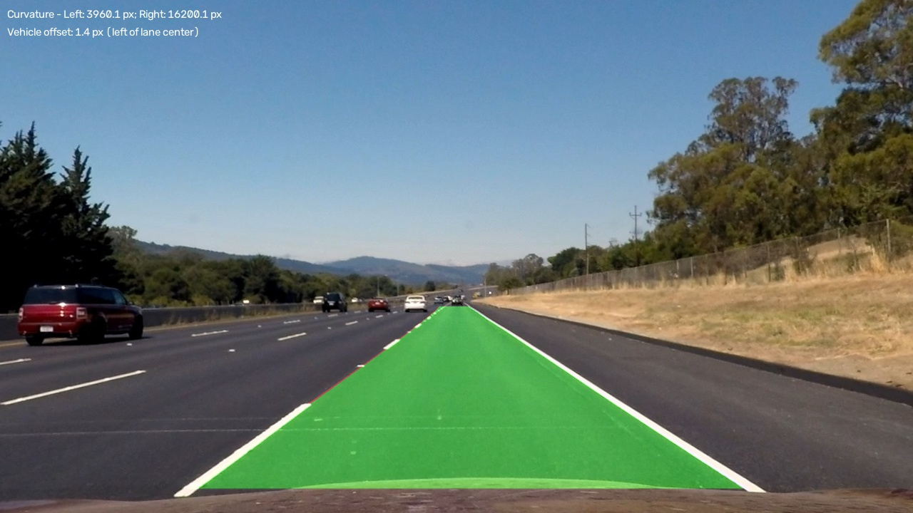
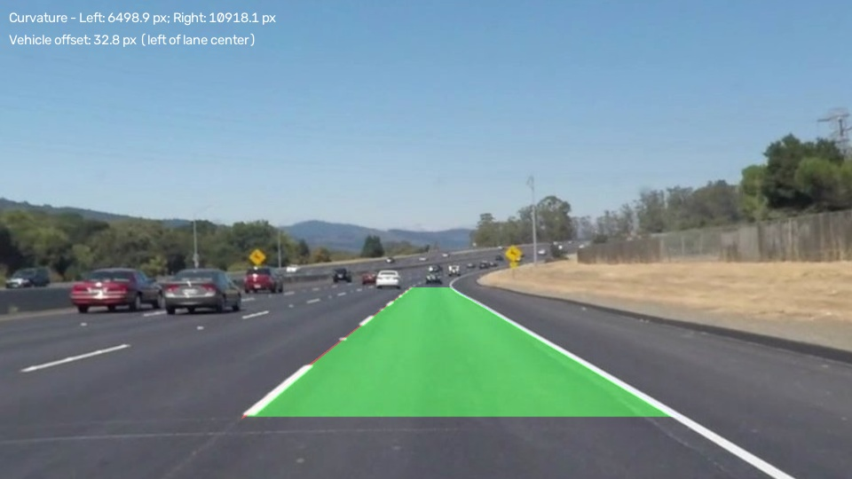
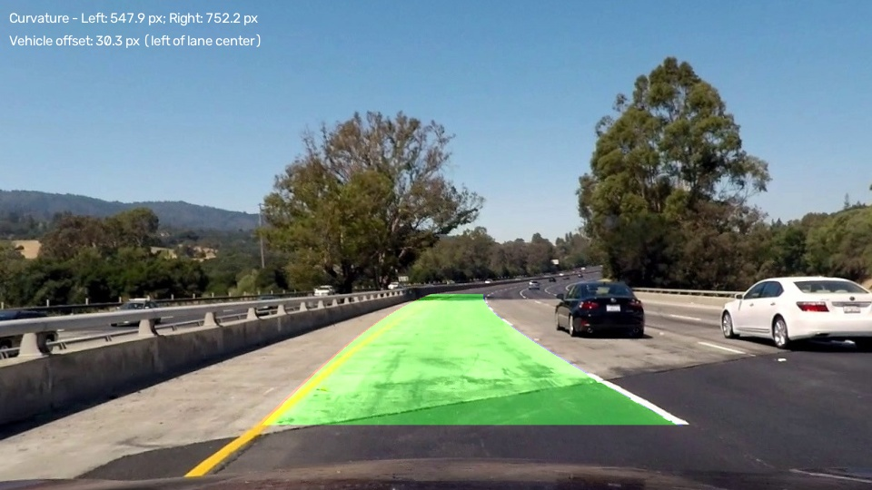

## Writeup Template

### You use this file as a template for your writeup.

---

**Lane Finding Project**

The goals / steps of this project are the following:

* Compute the camera calibration matrix and distortion coefficients given a set of chessboard images.
* Apply a distortion correction to raw images.
* Use color transforms, gradients, etc., to create a thresholded binary image.
* Apply a perspective transform to rectify binary image ("birds-eye view").
* Detect lane pixels and fit to find the lane boundary.
* Determine the curvature of the lane and vehicle position with respect to center.
* Warp the detected lane boundaries back onto the original image.
* Output visual display of the lane boundaries and numerical estimation of lane curvature and vehicle position.

[//]: # (Image References)

[image1]: ./examples/undistort_output.png "Undistorted"
[image2]: ./test_images/test1.jpg "Road Transformed"
[image3]: ./examples/binary_combo_example.jpg "Binary Example"
[image4]: ./examples/warped_straight_lines.jpg "Warp Example"
[image5]: ./examples/color_fit_lines.jpg "Fit Visual"
[image6]: ./examples/example_output.jpg "Output"
[video1]: ./project_video.mp4 "Video"

---

### Writeup / README

#### 1. Provide a Writeup that includes all the rubric points and how you addressed each one.

You're reading it!

### Camera Calibration

#### 1. Briefly state how you computed the camera matrix and distortion coefficients. Provide an example of a distortion corrected calibration image.

I implemented camera calibration in `main()` in [src/camera_calibration.py](src/camera_calibration.py). It reads images from `camera_cal/` and looks for a chessboard with **9 columns and 6 rows of internal corners**. I used `np.mgrid` to create a flat grid of 54 object points, with one chessboard square as the unit of distance.

I converted each image to grayscale with `cv2.cvtColor()` and found corners with `cv2.findChessboardCorners()`, using adaptive thresholding and image normalization. I then refined them with `cv2.cornerSubPix()`: an `(11, 11)` search window, up to 30 iterations, and an epsilon of `0.001`. The script skips unreadable images, failed detections, and images with different dimensions.

I passed the matching points from **15 successfully detected chessboard images at 1280x720** to `cv2.calibrateCamera()`. The RMS reprojection error was approximately **0.853 pixels**. The script saves the camera matrix, distortion coefficients, and calibration metadata (image size, RMS error, chessboard dimensions, and accepted/skipped image records) to `calibration_data/camera_calibration.npz`.

In [src/undistort_image.py](src/undistort_image.py), I loaded these arrays with `np.load(..., allow_pickle=False)` and used `cv2.undistort()` on `camera_cal/calibration10.jpg`. The script saves the corrected image and the comparison below. Neither image is cropped or resized.

![Original calibration image on the left and undistorted image on the right][doc_image1]

[doc_image1]: docs/calibration10_comparison.jpg "Calibration distortion correction"
[doc_image2]: docs/solidYellowCurve_perspective_source_points.jpg "Perspective source points"
[doc_image3]: docs/solidYellowCurve_hsv_canny_roi.jpg "HSV and Canny ROI mask"
[doc_image4]: docs/solidYellowCurve_hsv_canny_birds_eye.jpg "Bird's-eye binary mask"
[doc_image5]: docs/solidYellowCurve_sliding_windows.jpg "Sliding-window candidates"
[doc_image6]: docs/solidYellowCurve_polynomial_lanes.jpg "Quadratic lane candidates"
[doc_image7]: docs/solidYellowCurve_lane_overlay.jpg "Lane area in the original camera view"

### Pipeline (single images)

#### 1. Provide an example of a distortion-corrected image.

The comparison above shows distortion correction on a calibration image. The main image and video pipeline now supports `--undistort`. In `process_frame()` in [src/color_threshold.py](src/color_threshold.py), `cv2.undistort()` runs before color thresholding, grayscale conversion, Canny, ROI masking, and perspective transformation. The corrected image is used for diagnostics, overlay blending, and fallback frames. Without this option, the existing uncorrected behavior remains available.

For this assignment, I assume that the chessboard images, road images, and videos came from the same camera. I also treat 960x540 inputs as uniformly resized versions of the full 1280x720 camera view. These are explicit project assumptions, not independently verified capture metadata. The saved matrix is used directly for 1280x720; for 960x540, its first two rows are scaled by **0.75**, with distortion coefficients unchanged. Other resolutions are rejected when correction is enabled.

The saved parameters are loaded and validated once per image batch or video, not once per frame. Images are not resized or cropped, and corrected outputs receive an `_undistorted` suffix. Results with and without undistortion looked very similar, so I do not claim a significant improvement.

#### 2. Describe how (and identify where in your code) you used color transforms, gradients or other methods to create a thresholded binary image.  Provide an example of a binary image result.

In this project, I built a lane detector for road images and then reused it for video. All 17 test images run without runtime failures, although some detections are visually inaccurate. I describe the implementation and the experiments below, including what did not work well.

The six road-image figures in `docs/` now show the `solidYellowCurve.jpg` run with `--undistort`. Intermediate figures have no measurement labels; the final overlay shows curvature and vehicle offset in simple white text. The reported measurements and video results come from development runs, not comparisons against labeled ground truth.

The shared algorithm is in `process_frame()` in [src/color_threshold.py](src/color_threshold.py). `process_image()` loads an image, calls this function, and saves the diagnostics. I kept the same thresholds, fitting methods, validation, and filenames when adding video support.

I created the binary masks in `process_frame()` in [src/color_threshold.py](src/color_threshold.py). For images, `main()` accepts a filename from `test_images/`, defaults to `solidYellowCurve.jpg`, or processes all `.jpg`, `.jpeg`, and `.png` files with `--all`. Output names use the input image's stem. If one image fails, the batch continues with the others.

I converted the image to HSV with `cv2.cvtColor(image, cv2.COLOR_BGR2HSV)`. With `cv2.inRange()`, I selected yellow pixels between `[15, 80, 80]` and `[35, 255, 255]`, and white pixels between `[0, 0, 200]` and `[179, 50, 255]`. OpenCV uses hue values from 0–179 and saturation/value from 0–255. I combined the masks with `cv2.bitwise_or()`. These fixed ranges are sensitive to lighting.

I also converted the working image (corrected when `--undistort` is enabled) to grayscale, applied `cv2.GaussianBlur(gray, (5, 5), 0)`, and found edges with `cv2.Canny(blurred, 100, 170)`. The default method combines these edges with the HSV mask using `cv2.bitwise_or()`. This keeps lane pixels found by either method, but it also keeps some unrelated road edges and objects.

To focus on the road, I made an ROI mask with `np.zeros_like()` and `cv2.fillPoly()`, then applied it with `cv2.bitwise_and()`. Its vertices are `(0.35, 0.55)`, `(0.65, 0.55)`, `(0.95, 0.95)`, and `(0.00, 0.95)`, as fractions of image width and height. I kept the bottom wide enough for curved markings. The script saves the separate masks, color-filtered image, ROI mask and outline, Canny edges, and combined ROI mask so I can inspect each step. The masks are binary in memory, although saved JPEGs can contain compression artifacts.

![Existing combined HSV and Canny mask within the road ROI][doc_image3]

#### 3. Describe how (and identify where in your code) you performed a perspective transform and provide an example of a transformed image.

In `process_frame()`, I used `cv2.getPerspectiveTransform(source_points, destination_points)` to calculate the perspective matrix. I applied it to the HSV/Canny ROI mask with `cv2.warpPerspective()`, keeping the output size `(width, height)`. I used `cv2.INTER_NEAREST` so the binary mask does not gain intermediate values through interpolation.

I ordered the corners top-left, top-right, bottom-right, and bottom-left. The fixed source points are `(0.45, 0.60)`, `(0.55, 0.60)`, `(0.82, 0.95)`, and `(0.20, 0.95)`. Their matching destination points are `(0.25, 0.05)`, `(0.75, 0.05)`, `(0.75, 0.95)`, and `(0.25, 0.95)`. Each pair gives fractions of image width and height. This maps the road trapezoid to a rectangle.

The independent experiment in [src/perspective_transform.py](src/perspective_transform.py), `main()`, uses the same fixed point definitions to warp the color road image with `cv2.INTER_LINEAR`. Its source trapezoid is outlined before saving. The main pipeline also saves a labeled source-point visualization.

![Existing source-point diagnostic showing the road trapezoid][doc_image2]

![Existing warped HSV and Canny binary mask][doc_image4]

I chose these points manually, assuming a roughly flat road. They do not adjust to hills, camera movement, or every lane shape, so the warped boundaries are not always parallel or equally spaced. The transform also gives no pixel-to-meter scale. Unrelated features are still visible in the warped mask.

I also added an experimental adaptive option in `estimate_source_points(mask)`. It uses `cv2.HoughLinesP()` on the HSV/Canny ROI mask with rho `1`, theta `np.pi / 180`, threshold `50`, minimum line length `40`, and maximum gap `10`. It skips vertical segments and slopes smaller than `0.3` in magnitude. Negative and positive slopes form the left and right groups, which estimate boundary positions at `0.60 * height` and `0.95 * height`.

I added checks to avoid using poorly supported estimates. Each side needs at least three segments reaching within `0.05 * height` of the selected heights. I use median positions and require the 75th percentile of deviations to stay within `0.08 * width`. The corners must be finite, inside the image, and form a correctly ordered trapezoid that widens toward the bottom. Its top width must be `0.05–0.40 * width`, its bottom width `0.25–0.95 * width`, and the bottom must be more than `1.2` times as wide as the top. If a check fails, the code uses the fixed points and prints the selected mode. The warp, source-point image, and inverse overlay all use the same selected points.

I tested adaptive selection on **17 images. Only `solidYellowLeft.jpg` used the adaptive transform; the other 16 used the fixed fallback**. Since it was rarely accepted and did not show a clear visual improvement, I kept `USE_ADAPTIVE_PERSPECTIVE = False` as the default. This does not prove that fixed perspective is more accurate. Straight-segment estimates can struggle with curves and unrelated markings. The current documentation figures use fixed perspective.

#### 4. Describe how (and identify where in your code) you identified lane-line pixels and fit their positions with a polynomial?

To find starting positions in `process_frame()`, I summed the bottom half of the warped mask by column with `np.sum(birds_eye_mask[height // 2:, :], axis=0)`. I used `np.argmax()` to find one peak in the left half and one in the right half. If a half is empty or all zero, it has no starting candidate. I saved the histogram and peak positions as diagnostic images.

I searched upward using **9 horizontal windows**, with an **80-pixel margin** on each side of the current center. If a window contains at least **30 pixels**, I move the next window to their mean x-coordinate. Otherwise, I keep the previous center. Left and right coordinates are collected separately. The windows can still collect unrelated markings, and overlapping windows can collect the same pixels.

![Existing sliding-window search, with left windows green and right windows blue][doc_image5]

For each side, I remove non-finite points and require at least three points at three different y-coordinates. I fit `x(y) = a*y**2 + b*y + c` with `np.polyfit(y_points, x_points, 2, full=True)`. Fits with insufficient rank or non-finite coefficients are skipped. I evaluate the curves with `np.polyval()` and print their coefficients. The left diagnostic curve is green and the right is blue. Each is drawn only between its lowest and highest observed candidate rows, with drawing stopped outside the image.

![Quadratic-fit diagnostic from the undistorted pipeline][doc_image6]

Before drawing the lane area, I check that the boundaries have finite coordinates and positive separation. To allow moderate width variation, I reject a pair for inconsistent width only when the maximum is more than four times the minimum **and** the spread is more than half the image width. The polygon stays within the overlap of the observed y-ranges, with no extension. This overlap must cover at least two rows and 10% of the image height. Invalid or out-of-image sections are excluded, and separate valid sections are not joined across gaps. These checks catch implausible shapes, but they cannot tell whether the pixels belong to the correct lane.

#### 5. Describe how (and identify where in your code) you calculated the radius of curvature of the lane and the position of the vehicle with respect to center.

I reused the left and right fits from step 4, `x(y) = a*y**2 + b*y + c`. In [src/color_threshold.py](src/color_threshold.py), `radius_of_curvature(coefficients, y)` uses the first derivative `2*a*y + b` and second derivative `2*a` to calculate:

```text
R = (1 + (2*a*y + b)**2)**1.5 / abs(2*a)
```

I calculate curvature at `y = height - 1`. If `abs(a) < 1e-10`, the function returns an infinite radius for a nearly straight fit. Missing fits are reported as unavailable. The result is **in warped-image pixels, not meters**. This calculation can evaluate the curve below the observed pixels, so it is less reliable when it relies on extrapolation.

For the horizontal vehicle offset in `process_frame()`, I require both fits to pass geometry checks and have enough shared vertical support. I use the lowest valid row in that shared range, meaning the largest y where both boundaries are finite, inside the image, and in the correct left-to-right order. This calculation does not extend below the supported range. If no suitable row exists, the offset is unavailable.

I assume the camera and vehicle are horizontally centered at `image_width / 2` in the bird's-eye image:

```text
lane_center_x = (left_x + right_x) / 2
vehicle_center_x = image_width / 2
offset_px = vehicle_center_x - lane_center_x
```

A **positive** offset places the estimated vehicle to the **right** of lane center; a **negative** offset places it to the **left**. The terminal prints the evaluation y-coordinate, lane center, vehicle center, and signed pixel offset, and the per-image summary includes the available measurements.

The earlier verified terminal results without undistortion were **-0.99 px** for `straight_lines2.jpg`, **-15.88 px** for `solidYellowCurve.jpg`, and **-29.94 px** for `challange00101.jpg`. All three place the estimated vehicle to the left of lane center under the centered-camera assumption.

I have not established a pixel-to-meter scale or independently verified the centered-camera assumption. Camera compatibility is assumed for this project. I report both offset and curvature in pixels, without assuming a physical lane width. Final image and video frames now show these values as two simple white text labels in `px`, including the offset direction. `SHOW_MEASUREMENTS = True` enables the labels; unavailable measurements are shown as unavailable.

#### 6. Provide an example image of your result plotted back down onto the road such that the lane area is identified clearly.

To make the final overlay in `process_frame()`, I start with an empty BGR image in bird's-eye coordinates. I form polygons between the fitted curves within their shared observed y-range, using only valid, in-image rows with the left boundary before the right. Separate valid sections are handled separately. I fill the area green with `cv2.fillPoly()`, draw the left boundary red, and draw the right boundary blue. The checks from step 4 must pass first. If a fit is missing, support is insufficient, or a safe polygon cannot be formed, the script prints why the overlay was skipped.

I reverse the perspective transform with `cv2.getPerspectiveTransform(destination_points, source_points)`, using the same points as before. Then `cv2.warpPerspective()` maps the colored area back to the original camera view. I blend it with the road using `cv2.addWeighted(image, 1.0, warped_lane_area, 0.4, 0)`, so the road remains visible. The image wrapper saves it as `<image_stem>_lane_overlay.jpg`, or `<image_stem>_lane_overlay_undistorted.jpg` with correction enabled.

![Undistorted lane overlay with curvature and vehicle-offset labels][doc_image7]

This figure was copied from `output_images/solidYellowCurve_lane_overlay_undistorted.jpg`. It shows the lane area, boundaries, and plain white curvature and vehicle-offset labels in pixels. Measurements and validation messages also remain in the terminal. It is an example of the result on one image, not an accuracy score for the whole test set.







### Pipeline (video)

#### 1. Provide a link to your final video output.  Your pipeline should perform reasonably well on the entire project video (wobbly lines are ok but no catastrophic failures that would cause the car to drive off the road!).

I added video processing in [src/video_pipeline.py](src/video_pipeline.py). For example, `python src/video_pipeline.py project_video01.mp4` reads that file from `test_videos/`. I use `cv2.VideoCapture()` to open it, check the first frame, and read the FPS. Invalid FPS is rejected rather than replaced with a guessed value. Adding `--undistort` enables shared camera correction, with calibration loaded once before frame processing.

The first frame sets the output dimensions. I use `cv2.VideoWriter()` with the `mp4v` codec, the same dimensions, and the input FPS. The result is saved to `output_videos/<video_stem>_lane_overlay.mp4`, creating the folder if needed. With `--undistort`, the filename ends in `_lane_overlay_undistorted.mp4`. Frames are not resized or deliberately skipped. A dimension change stops processing, and detectable read/write errors are reported. The capture and writer are released even after an error. OpenCV cannot identify every decoding or encoding failure, and this writer does not preserve audio.

For each BGR frame, I call `process_frame(frame, diagnostics=False, verbose=False)`. It returns the BGR result, measurements and validation information, and optional diagnostic images. It uses the same image algorithm, with fixed perspective by default and no extension of the lane polygon beyond shared support. I disable diagnostic images and detailed printing during video processing. Measurements remain available in the returned metadata and appear in plain white text on final frames when `SHOW_MEASUREMENTS` is enabled.

If detection is rejected or lane processing raises an exception, I write the working frame, corrected when `--undistort` is enabled, so the video stays continuous. Calibration and undistortion failures are reported rather than silently using uncorrected frames. At the end, the script reports frames written, accepted and rejected detections, and processing errors. It processes frames independently, without temporal smoothing or tracking.

Existing local outputs:

* project_video01 lane-overlay video: the run wrote **221 frames, with 221 accepted detections, 0 rejected detections, and 0 processing errors**. I confirmed that it plays in Windows Media Player. These counts show that processing worked, not that every boundary was correct.
* project_video02 lane-overlay video: I reviewed the video and found that it worked reasonably well, but not perfectly. I have not reported extra frame totals or accuracy scores for it.
* challenge01 lane-overlay video: I noticed more inaccuracies around shadows and distracting edges. Later sections looked better, but I did not measure an accuracy difference between sections.

The videos above are from the earlier evaluation. The final undistorted outputs with measurement labels are:

* [project_video01: main successful demonstration](output_videos/project_video01_lane_overlay_undistorted.mp4).
* [challenge01: more difficult road conditions](output_videos/challenge01_lane_overlay_undistorted.mp4), where shadows and changing conditions sometimes cause incorrect lane detection. Accepted frames do not necessarily have accurate boundaries.

These two final videos are local files prepared for Git tracking, not videos already published online. Other generated video outputs remain ignored.

To investigate `challenge01.mp4`, I compared six frames: **0, 25, 88, 138, 200, and 238**. I saved the originals, color masks, Canny edges, combined and ROI masks, bird's-eye masks, sliding windows, fitted curves, and text-free overlays under `output_images/challenge01_diagnostics/`.

All six passed geometry checks and produced overlays. However, the diagnostics showed fragmented white markings, shadow edges, unrelated contours, and clutter inside the warped search windows. The strongest tree shadows in these samples were around frame 88, not at the beginning. Frame 138's overlay stopped higher because its right-side pixel support ended earlier. I found that a frame can process successfully and pass geometry checks while still identifying the lane incorrectly.

I then tested color-gated Canny on the same six saved frames, changing no other parameters. The default combination is `HSV | Canny`. The optional call `process_frame(..., color_gated_canny=True, dilation_kernel_size=5)` instead uses `HSV | (Canny & dilate(HSV))`. A single dilation with a 5-by-5 kernel allows edges near HSV-selected pixels. It does not expand the retained HSV pixels themselves. Both methods produced accepted detections on all six frames.

The gated masks had fewer unwanted shadow and guardrail edges, but they also lost useful lane edges. In frame 88, the overlay ended noticeably earlier near the car. Frames 138 and 238 lost support farther up the road. Frame 88's nonzero ROI pixel count dropped from **12,627 to 7,714**, and frame 138's dropped from **9,478 to 6,199**. Fewer pixels did not automatically mean a better result.

I kept unrestricted HSV/Canny as the default for images and videos. Color gating was **inconclusive as an accuracy improvement**, and some overlays covered less of the visible lane. The optional mode remains available for further experiments.

The sample report, color-gating report, and measurements contain the details. In the side-by-side images, baseline is on the left and gated is on the right. These files are local diagnostics under the ignored `output_images/` folder, so they are not included automatically in a repository checkout.

### Discussion

#### 1. Briefly discuss any problems / issues you faced in your implementation of this project.  Where will your pipeline likely fail?  What could you do to make it more robust?

I started with straight-line detection in [src/lane_detection.py](src/lane_detection.py), using grayscale conversion, a `(5, 5)` Gaussian blur, Canny thresholds `100/170`, and probabilistic Hough detection. I saved full-image and ROI results separately, then added slope filtering and left/right straight fits. Testing this approach on `solidYellowCurve.jpg` led me to try color masks, a bird's-eye view, sliding windows, and quadratic fits for curved lanes.

The saved images helped me adjust the coordinates. The ROI initially cut off the lower yellow marking, so I moved its lower-left corner to `0.00 * width` while keeping space for the right dashed marking. I narrowed an overly wide perspective trapezoid, then moved its lower-right x fraction from `0.72` to `0.82`. I also tried a top-right fraction of `0.53` for `straight_lines1.jpg`, but removed that image-specific change. All images now use `0.55`. These changes improved the manual alignment being tested; they do not make the transform suitable for every road or camera.

Two experiments did not give a clear reason to replace the baseline. Adaptive perspective was accepted for only 1 of 17 images, and color-gated Canny removed useful support along with clutter. I therefore kept fixed perspective and unrestricted HSV/Canny as the defaults. The detailed results are in the perspective and video sections; neither experiment established which method is more accurate against ground truth.

I also limited how far the fitted curves are drawn. Diagnostic curves stop at their observed y-ranges, and the final polygon uses only their shared range. Geometry checks reject crossed boundaries and extreme width changes. These changes avoid filling large unsupported areas, but a plausible shape can still follow the wrong pixels. Curvature is still evaluated at the image bottom, even when the observed support ends earlier.

The diagnostics showed unrelated road edges and bright objects in the masks. Shadows and fragmented markings were especially troublesome in `challenge01.mp4`. I also expect glare, faded paint, occlusion, hills, camera-pose changes, and neighboring markings to cause problems. A histogram peak can start on the wrong feature, windows can collect unrelated or shared pixels, and the adaptive estimator's slope filtering can struggle on strong curves. The fixed transform does not guarantee constant lane width either.

The video tests made the difference between processing success and visual quality clear. `project_video01.mp4` encoded and played correctly, and `project_video02.mp4` looked reasonably good. However, the six inspected challenge frames all passed validation even though their masks and overlays had problems. Since each frame is processed independently, moving fits and lost support can cause flicker or abrupt cutoffs. I have not added smoothing or tracking yet.

The measurements also have limits. Offset assumes a centered camera, and both offset and curvature are in pixels. The same-camera and uniform-resizing relationships are project assumptions, and I still need a justified scale before reporting meters.

**Remaining TODO:** I would like to review more video sections against labeled lanes, record run settings and rejection reasons, and test lighting-robust thresholds and stronger pixel selection. Other possible improvements are fit-confidence checks, curvature evaluated within observed support, temporal smoothing, tracking, and recovery after lost detections. These are ideas for controlled tests, not improvements that I have already demonstrated.